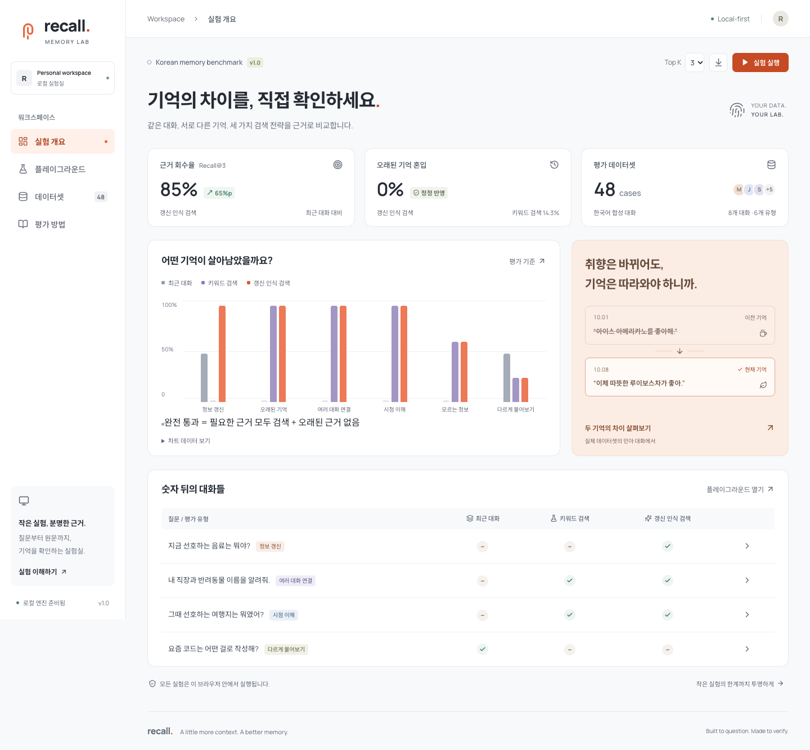
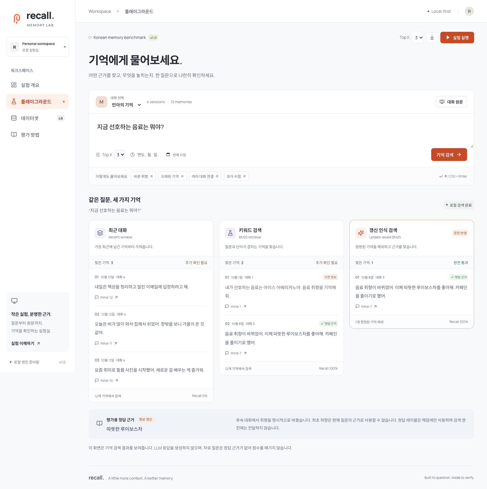
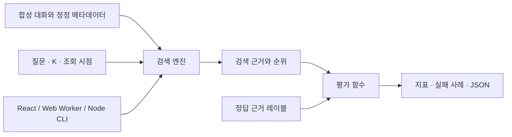

# Recall — AI Memory Lab

**같은 대화, 서로 다른 기억. 검색 전략의 차이를 근거로 확인하는 로컬 실험실.**

Recall은 긴 대화에서 필요한 정보를 찾고, 바뀐 정보를 갱신하는 과정을 시각적으로 비교하는 웹 애플리케이션입니다. 한국어 합성 대화 8개와 질문 48개를 사용해 최근 대화, BM25, 갱신 인식 BM25를 동일한 조건에서 실행합니다.

React · TypeScript · Vite · Web Worker · Vitest · Playwright · axe-core



## 왜 만들었나요?

사용자가 처음에는 “아이스 아메리카노를 좋아해”라고 했다가 나중에 “이제 루이보스차가 좋아”라고 말할 수 있습니다. 과거 대화에서 관련 문장을 찾는 것만으로는 현재의 취향을 올바르게 기억한다고 볼 수 없습니다.

이 프로젝트는 세 가지 질문에서 시작했습니다.

1. 최근 대화 밖의 필요한 정보를 찾을 수 있는가?
2. 새 정보가 생겼을 때 이전 정보를 계속 가져오지는 않는가?
3. 답할 근거가 없는 질문에서 검색을 멈출 수 있는가?

**이 프로젝트가 측정하는 것은 검색 품질입니다. LLM 답변 정확도나 상용 AI의 기억 성능을 측정한 결과가 아닙니다.** API 키, 유료 모델 호출, 백엔드 서버 없이 실행합니다.

## 빠르게 실행하기

Node.js 22 이상과 npm이 필요합니다.

```bash
npm ci
npm run dev
```

터미널에 표시되는 로컬 주소를 엽니다. 기본 주소는 `http://127.0.0.1:5173`입니다.

```bash
npm test                 # 검색·채점·데이터셋 단위 테스트
npm run benchmark        # 실제 벤치마크 실행 및 JSON 저장
npm run build            # TypeScript 검사 + 프로덕션 빌드
npx playwright install chromium
npm run test:e2e         # 브라우저·반응형·접근성 테스트
```

이미 Chrome이 설치된 환경에서는 브라우저 추가 다운로드 없이 다음 명령을 사용할 수 있습니다.

```bash
PLAYWRIGHT_CHANNEL=chrome npm run test:e2e
```

`npm run preview`로 빌드 결과를 확인할 수 있습니다. `dist/`는 정적 호스팅에 배포할 수 있으며, 화면 이동에 hash routing을 사용하므로 서버의 경로 재작성 설정이 필요하지 않습니다. 이 저장소 자체에는 공개 배포나 외부 계정 연결이 포함되어 있지 않습니다.

## 직접 해보기

1. **실험 개요**에서 세 전략의 유형별 통과율을 비교합니다.
2. **플레이그라운드**에서 민아의 “바뀐 취향” 사례를 엽니다.
3. 키워드 검색이 이전 취향과 새 취향을 함께 가져오는지 확인합니다.
4. 갱신 인식 검색의 출처를 눌러 원문과 정정 관계를 확인합니다.
5. “과거 시점”을 선택합니다. 정정 이전 시점에서는 최초 취향이 유효한 근거가 됩니다.
6. “카페에서 뭘 주문해 주면 좋을까?”처럼 표현을 바꿉니다. 단어 검색이 의미를 이해하지 못하는 한계를 확인합니다.
7. Top K를 바꿔 실험을 다시 실행하고 결과 JSON을 내보냅니다.



### 주요 기능

- 실제 계산값을 사용하는 대시보드와 접근 가능한 차트 데이터 표
- 세 검색 전략의 근거·순위·과거 정보 혼입 비교
- 조회 시점 설정과 미래 정보 유입 방지
- 원문 대화와 `supersedes` 정정 관계 추적
- 자유 질문, 대화 선택, K=1/3/5 비교
- 데이터셋 유형 필터와 질문·인물 검색
- 원본 데이터 및 실험 결과 JSON 다운로드
- Worker 실행 상태, 오류 안내, 빈 결과, 설정과 결과의 불일치 안내
- 모바일 내비게이션, 키보드 조작, reduced motion, 로컬 글꼴

자유 질문에는 정답 레이블이 없으므로 “미채점”으로 표시합니다. 실험 결과는 메모리에만 유지되며, 새로고침하면 기본 조건으로 다시 계산합니다. 기록을 보존하려면 JSON을 내보내야 합니다.

## 실제 실험 결과

`recall-ko-synthetic-1.0`, K=3, 48개 질문 × 3개 전략. 아래 수치는 `npm run benchmark`로 계산한 결과입니다. 원본은 [benchmark-results.json](docs/benchmark-results.json)에 있습니다.

| 전략           | Recall@3 ↑ | MRR ↑ | 오래된 기억 혼입 ↓ | 검색 보류 정확도 ↑ | 완전 통과 |
| -------------- | ---------: | ----: | -----------------: | -----------------: | --------: |
| 최근 대화      |      20.0% | 0.200 |               0.0% |               0.0% |    8 / 48 |
| BM25           |      85.0% | 0.750 |              14.3% |              62.5% |   31 / 48 |
| 갱신 인식 BM25 |      85.0% | 0.850 |               0.0% |              62.5% |   39 / 48 |

이 데이터에서 정정 관계를 적용하면 BM25의 Recall은 그대로이지만 오래된 근거가 제외되고 첫 정답의 순위가 개선되었습니다. 반면 표현 변경과 근거 없는 질문의 실패는 남았습니다. 최근 대화의 혼입률 0%는 검색 품질이 높다는 뜻이 아닙니다. 필요한 근거를 대부분 놓치는 전략도 혼입률은 낮을 수 있으므로 여러 지표를 함께 읽어야 합니다.

### 지표 정의

- **Recall@K:** 검색한 정답 근거 수 / 전체 정답 근거 수. 정답 근거가 있는 40개 질문에서 macro average를 계산합니다.
- **MRR:** 첫 정답 근거 순위의 역수 평균. 정답이 없으면 0이며, 근거 없는 8개 질문은 분모에서 제외합니다.
- **오래된 기억 혼입:** 조회 시점에 이미 정정된 검색 근거 수 / 검색된 전체 근거 수. 시점 이전에는 유효했던 정보는 오래된 정보로 판정하지 않습니다.
- **검색 보류 정확도:** 근거 없는 8개 질문 중 결과를 반환하지 않은 질문의 비율입니다. 답할 수 있는 질문까지 포함한 종합 분류 정확도는 아닙니다.
- **완전 통과:** 모든 정답 근거를 찾고 오래된 근거가 없어야 합니다. 근거 없는 질문은 결과가 비어 있어야 합니다. 다른 최신 문장의 혼입까지 모두 벌점으로 처리하는 precision 지표는 아닙니다.

실행 시간은 기기, 브라우저, JIT, 최초 실행 여부에 따라 달라집니다. 이 작은 데이터셋의 단발성 측정값으로 속도 우위를 주장하지 않습니다.

## 어떻게 구현했나요?



### 설계 선택

**검색과 채점 분리.** `retrieve()`는 대화, 질문, 전략, 설정만 받습니다. 정답 ID와 정답 문장은 `scoreCase()`에만 전달합니다. 정답을 바꿔도 검색 결과가 바뀌지 않는 테스트로 데이터 유출을 점검합니다.

**시점 필터를 먼저 적용.** 미래의 정정 정보를 먼저 읽으면 과거 질문의 답을 잘못 지울 수 있습니다. 따라서 조회 시점 필터 → 유효한 정정 관계 확인 → 후보 필터 → BM25 순으로 실행합니다.

**명시적 정정 메타데이터.** `supersedes`는 사람이 데이터 작성 시 지정한 관계입니다. 자연어에서 변경 사항을 자동 추론하는 기능을 구현한 것처럼 표현하지 않았습니다. 현재 구현은 더 많은 입력 정보가 주어졌을 때의 검색 동작을 비교합니다.

**작고 설명 가능한 검색기.** 한국어 조사 제거와 글자 bigram, BM25(k₁=1.2, b=0.75)를 사용합니다. IDF는 `ln(1 + (N - df + 0.5) / (df + 0.5))`인 양수형 변형입니다. 형태소 분석기나 임베딩 모델을 사용하지 않습니다. 같은 점수에서는 최신 시각, ID 순서로 결정해 재현성을 유지합니다.

**하나의 엔진, 두 실행 환경.** UI와 Node CLI가 같은 TypeScript 모듈을 사용합니다. 초기 화면의 작은 데이터는 직접 계산하고, 사용자가 다시 실행하는 벤치마크는 Web Worker로 분리합니다. 진행률은 실제 평가 완료 수에서 계산합니다.

**외부 서비스 없는 실행.** 모델 API, 분석 SDK, 원격 데이터베이스를 사용하지 않습니다. 글꼴도 패키지로 묶어 로컬에서 제공합니다. 앱 자산을 불러온 뒤의 검색과 채점은 브라우저 안에서 수행됩니다.

## 데이터셋과 한계

| 항목   | 구성                                                                      |
| ------ | ------------------------------------------------------------------------- |
| 대화   | 가상 인물 8명 × 기억 12개 = 96개                                          |
| 세션   | 인물당 4회                                                                |
| 질문   | 인물당 6개 = 48개                                                         |
| 유형   | 정보 갱신, 오래된 기억, 여러 대화 연결, 시점 이해, 모르는 정보, 표현 변경 |
| 최근성 | 4개 대화의 정정은 최근 K=3 안에, 나머지 4개는 밖에 위치                   |
| 정답   | 기대 근거 ID를 수동 지정                                                  |

- 48개 질문은 8개 대화 템플릿에서 파생되어 독립 표본이 아닙니다.
- 공개 연구 데이터셋의 복제본이 아니며, 실제 사용자 데이터도 아닙니다.
- 별도의 held-out test set, 통계적 유의성, 모델별 비교를 수행하지 않았습니다.
- 갱신 인식 전략에만 명시적 정정 정보가 주어집니다. 입력 조건이 다른 비교임을 고려해야 합니다.
- 어휘 검색은 동의어·함축·문맥·복잡한 부정을 충분히 처리하지 못합니다.
- 단어가 겹치지 않으면 검색을 보류할 뿐, “모른다”는 의미를 이해하는 모델은 아닙니다.
- 근거가 있지만 검색을 보류하는 오류는 Recall에서 드러납니다.
- `supersedes`는 한 기억 전체를 대체합니다. 여러 사실을 포함한 문장의 부분 정정은 지원하지 않습니다.
- 저장된 모든 시간은 UTC이며, 날짜 선택은 해당 날짜 UTC 23:59:59를 경계로 사용합니다.

## 검증

검증 일자: 2026-11-11. 상세 기록은 [QA.md](docs/QA.md)에 있습니다.

- **Vitest 27개:** 최신 정정, 과거 시점, 경계 시간, 검색 보류, 다중 근거 채점, MRR, 지표 분모, 정답 레이블 비유입, 재현성, 데이터 무결성
- **Playwright 14개:** Worker 재실행, JSON 다운로드, 검색·필터·원문 보기, 키보드 닫기, 빈 입력, 모바일 내비게이션, 화면 캡처
- **axe-core:** 4개 주요 화면에서 WCAG 2 A/AA 및 2.1 AA 자동 검사
- **화면 크기:** 데스크톱 1440px, 태블릿 768px, 모바일 390px
- **빌드:** TypeScript strict 검사와 프로덕션 빌드

자동 접근성 검사가 모든 접근성을 보장하지는 않습니다. 스크린리더를 사용한 전체 수동 감사나 Safari·Firefox의 전체 E2E 검증은 수행하지 않았습니다.

## AI를 활용한 구현 흐름

이 프로젝트는 AI가 코드와 테스트 초안을 만들고 도구로 실제 실행 결과를 검증한 **AI-assisted engineering** 작업입니다. AI 제품의 화면을 모방하는 것에 그치지 않고, 디자인 기준과 검토 단계를 명시하는 방식으로 진행했습니다.

| 단계             | 참고하거나 적용한 도구                                            | 이 프로젝트에 남긴 결과                    |
| ---------------- | ----------------------------------------------------------------- | ------------------------------------------ |
| 디자인 방향      | Anthropic `frontend-design`의 계획 → 검토 → 구현 → 비평 흐름 참고 | 제품 맥락, 글꼴·색·상태 규칙               |
| 구현·마무리      | 로컬 `impeccable`의 context, craft floor, polish 기준 적용        | 렌더링 후 글자 크기·대비·반응형 수정       |
| React 설계       | Vercel `react-best-practices`의 성능 우선순위 참고                | 재실행 Worker, 불필요한 AI SDK 의존성 제외 |
| 기능 검증        | Vitest + Playwright                                               | 재실행 가능한 자동 테스트와 스크린샷       |
| 시각·접근성 검증 | 실제 브라우저 캡처 + axe-core + Impeccable detector               | 대비 문제, ARIA 역할, 가로 넘침 발견·수정  |
| 문서화           | 실행 로그와 결과 JSON을 근거로 작성                               | 결과·한계·재현 절차                        |

실제 수행 범위와 참고한 사례, 병렬 에이전트 실행 제한은 [AI_WORKFLOW.md](docs/AI_WORKFLOW.md)에 구분해 기록했습니다. 스킬을 설치하거나 읽었다는 사실 자체를 품질 검증으로 간주하지 않습니다.

## 폴더 구조

```text
src/
  App.tsx                 # 화면 이동, Worker 생명주기, 원문 패널
  styles.css              # 토큰, 컴포넌트, 반응형, 상태
  components/
    Overview.tsx          # 실험 요약과 사례 비교
    Playground.tsx        # 자유 질문과 검색 근거
    Dataset.tsx           # 데이터 검색·필터·내보내기
    Methods.tsx           # 평가 방법과 한계
    Shared.tsx            # 공통 표시 컴포넌트
  engine/
    types.ts              # 입력·결과·지표 계약
    dataset.ts            # 합성 대화와 기대 근거
    retrieval.ts          # 세 검색 전략
    evaluation.ts         # 채점과 집계
    benchmark.worker.ts   # 비동기 벤치마크 실행
tests/                    # 단위 테스트와 브라우저 테스트
scripts/benchmark.ts      # UI와 동일한 엔진으로 결과 생성
docs/                     # 실제 결과, 화면, 검증 및 작업 기록
```

## 포트폴리오에서 설명할 핵심

> 대화형 AI의 기억을 평가하기 위해 검색과 채점을 분리한 로컬 실험 도구를 구현했습니다. 과거 시점에 미래 정보가 유입되는 오류, 정정된 기억이 계속 검색되는 오류, 근거 없는 질문의 오탐을 재현하고 테스트했습니다. 점수만 보여주는 대신 원문과 실패 사례를 연결해 설계 선택을 설명할 수 있도록 만들었습니다.

면접에서는 **왜 임베딩을 쓰지 않았는지**, **Recall이 같아도 결과 품질이 달라지는 이유**, **정정 메타데이터의 비용**, **이 실험이 증명하지 못한 것**을 코드와 실제 사례로 설명할 수 있습니다.

다음 단계로는 독립적으로 작성한 평가 세트, 부분 사실 단위의 갱신, 한국어 임베딩 비교, 보류 임계값 평가를 고려할 수 있습니다. 이 항목들은 현재 구현된 기능이 아닙니다.

## 참고 자료

- [LongMemEval](https://github.com/xiaowu0162/LongMemEval): 기억 평가 유형 설계 참고. 데이터나 공식 벤치마크 점수를 사용한 것은 아닙니다.
- [Anthropic frontend-design](https://github.com/anthropics/skills/blob/main/skills/frontend-design/SKILL.md): AI 디자인 작업의 계획·검토·구현·비평 흐름 참고.
- [Impeccable polish](https://impeccable.style/docs/polish/): 상태·반응형·시각 디테일 검토 흐름.
- [Vercel React Best Practices](https://vercel.com/blog/introducing-react-best-practices): 성능 문제의 우선순위와 에이전트용 가이드 사례.
- [Playwright Trace Viewer](https://playwright.dev/docs/trace-viewer): 실패 시 동작 경로를 추적하는 검증 도구.
- 글꼴: Manrope 및 Noto Sans KR. 각 패키지에 포함된 OFL 라이선스를 따릅니다.
