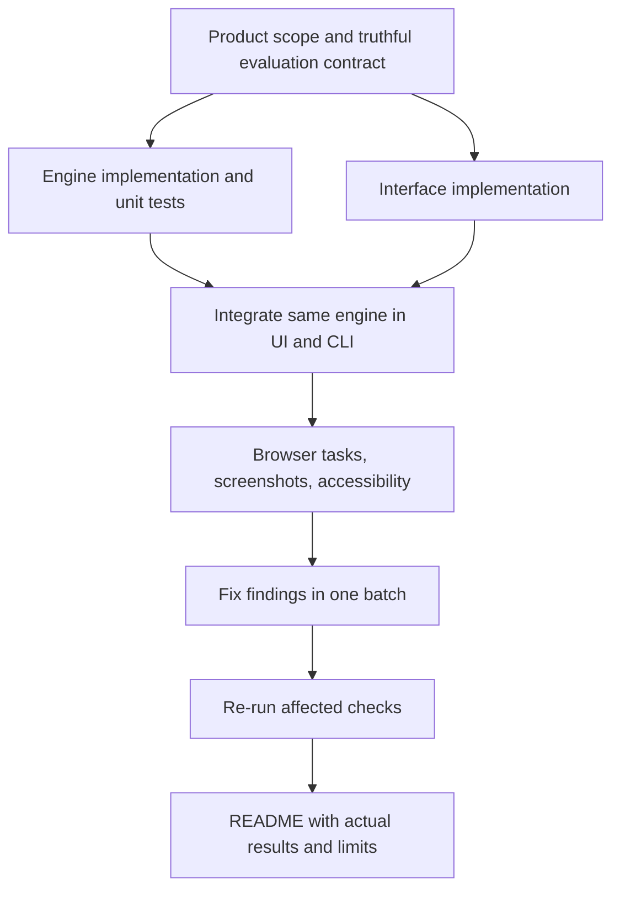

# AI-assisted implementation workflow

## User intent and correction

The request was to implement an AI memory experiment with tests, a polished interface, and a portfolio README. The user clarified that the reference request concerned **which skills and agent workflows to use for building UI**. The initial interpretation as a request for AI product interface references was corrected while implementation continued.

## Sources consulted

- [Anthropic frontend-design](https://github.com/anthropics/skills/blob/main/skills/frontend-design/SKILL.md): establish a brief-specific visual plan, review it, implement, and critique the rendered result.
- [Vercel React Best Practices](https://vercel.com/blog/introducing-react-best-practices): prioritize larger execution and bundle problems before micro-optimizations. Consulted as guidance, not installed as an additional skill.
- Local **Impeccable 4.8.0**: read `SKILL.md`, ran `context`, read `craft-floor` and `polish`, and ran the mechanical detector once. Used for refinement of the implementation already in progress. This was not a full comp-led Impeccable concept-selection workflow.
- Local **Playwright** skill: read browser verification guidance. Durable `@playwright/test` specs provide the requested repeatable tests, screenshots and failure traces.
- [Lazyweb](https://www.lazyweb.com/agentic-search/dd9962ae-c57f-4ec3-b978-58873db44e65): connected successfully and retrieved a small set of dashboard references. This link may require the owning account.

## Intended responsibility split

Separate-agent delegation was attempted but failed because the session's inherited model was unavailable to the agent service. The implementation and review steps were performed sequentially by the primary agent. **No independent-agent review or successful parallel-agent execution is claimed.**

## Observable review loop

1. Implemented the pure retrieval/evaluation modules and the browser UI.
2. Executed unit tests and generated a real benchmark JSON file.
3. Drove search, date cutoffs, source inspection, filters, exports and Worker reruns in a real browser.
4. Captured desktop, tablet and mobile screens.
5. Increased small text and corrected insufficient contrast, missing ARIA roles and a mobile overflow caused by absolutely positioned screen-reader text inside a table.
6. Re-ran the browser checks and preserved screenshots and results.

The local Impeccable detector reported no findings in its scan. This is not a substitute for browser tests or visual inspection.

## External-report limitation

Lazyweb's greenfield report request returned a redirect to a workflow that the server then reported as unavailable. Once a screen existed, an upload for a report was attempted. The first upload failed; the subsequent upload was rejected by automatic approval review because the screen capture had not been explicitly approved for transfer to the external destination. No hosted design report was produced. The upload was not retried through an alternate route; local review continued instead.

## Reusing this workflow

Keep responsibilities and acceptance criteria explicit. Provide the retrieval contract to the UI implementer; let the evaluator consume gold labels only after retrieval; review the rendered screen at the actual viewport sizes; preserve failing examples rather than retuning the dataset until all scores are high. Record which steps were actually executed, which were only referenced, and which were unavailable.
